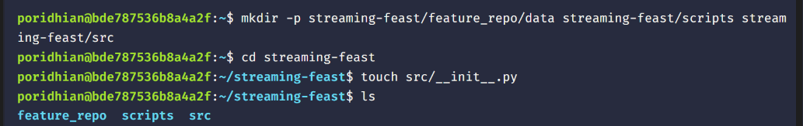
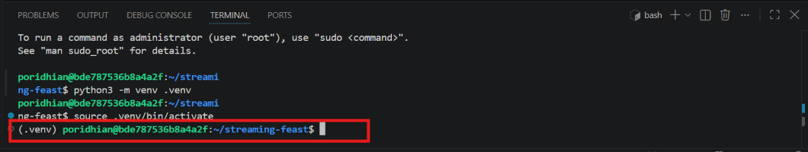
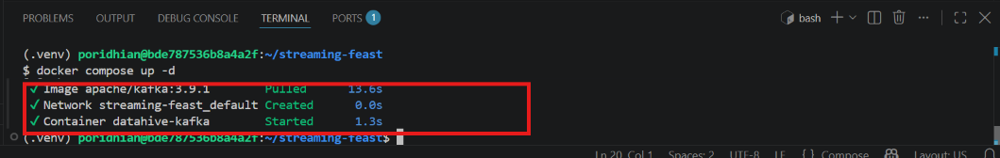
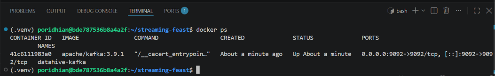
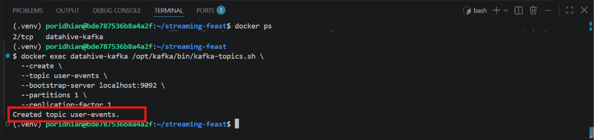
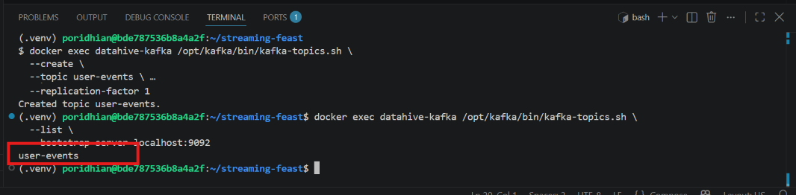
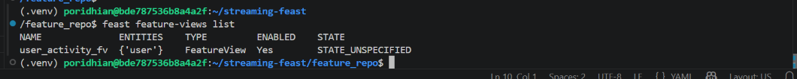
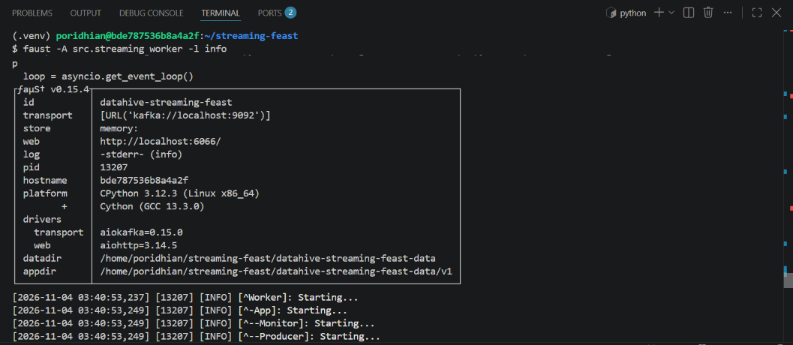
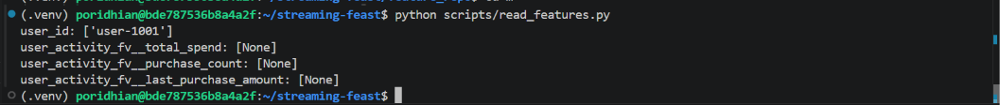

# Lab - Streaming Feast: Real-Time Feature Updates with Kafka and Faust

**Level:** Advanced


## Introduction

DataHive is building a real-time recommendation service for an
e-commerce platform. When a customer makes a purchase, the event must be
processed immediately so the recommendation service can use the
customer's latest activity features. In this lab, the team will use
Kafka to receive purchase events, Faust to process them, and Feast's
Push API to update the online feature store as events arrive.

## Project Structure

Create the following project structure:

``` text
streaming-feast/
├── feature_repo/
│   ├── data/
│   ├── feature_store.yaml
│   └── feature_definitions.py
├── scripts/
│   ├── produce_events.py
│   └── read_features.py
├── src/
│   ├── __init__.py
│   └── streaming.py
├── docker-compose.yml
└── requirements.txt
```

## Architecture


## Chapter 1 --- Prepare the Development Environment

Open a terminal and create the project directories:

**Linux / macOS (Bash):**
``` bash
mkdir -p streaming-feast/feature_repo/data streaming-feast/scripts streaming-feast/src
cd streaming-feast
touch src/__init__.py
```


**Windows (PowerShell):**
``` powershell
New-Item -ItemType Directory -Force -Path streaming-feast/feature_repo/data, streaming-feast/scripts, streaming-feast/src
Set-Location streaming-feast
New-Item -ItemType File -Force -Path src/__init__.py
```

Create `requirements.txt`:

``` text
feast>=0.54
faust-streaming>=0.11
kafka-python>=2.2
pandas>=2.2,<3
```

*(Note: Using `feast>=0.54` ensures compatibility with modern Python versions including Python 3.12+, which require pre-built wheels for `pyarrow`.)*

Create and activate a virtual environment:

**Linux / macOS (Bash):**
``` bash
python3 -m venv .venv
source .venv/bin/activate
```


**Windows (PowerShell):**
``` powershell
python -m venv .venv
.venv\Scripts\Activate.ps1
```

Install the dependencies:

``` bash
python -m pip install --upgrade pip
python -m pip install -r requirements.txt
```

The virtual environment keeps this lab's Python packages separate from
system Python. Feast manages feature definitions and online feature
retrieval, while Faust consumes and processes Kafka events. The Kafka
producer package is used to publish sample purchase events during
testing.

## Chapter 2 --- Start the Kafka Broker

> **Prerequisite:** Ensure Docker Desktop or the Docker daemon is running before starting Kafka.

Create `docker-compose.yml`:

``` yaml
services:
  kafka:
    image: apache/kafka:3.9.1
    container_name: datahive-kafka
    ports:
      - "9092:9092"
    environment:
      KAFKA_NODE_ID: 1
      KAFKA_PROCESS_ROLES: broker,controller
      KAFKA_LISTENERS: PLAINTEXT://:9092,CONTROLLER://:9093
      KAFKA_ADVERTISED_LISTENERS: PLAINTEXT://localhost:9092
      KAFKA_CONTROLLER_LISTENER_NAMES: CONTROLLER
      KAFKA_LISTENER_SECURITY_PROTOCOL_MAP: CONTROLLER:PLAINTEXT,PLAINTEXT:PLAINTEXT
      KAFKA_CONTROLLER_QUORUM_VOTERS: 1@localhost:9093
      KAFKA_INTER_BROKER_LISTENER_NAME: PLAINTEXT
      KAFKA_OFFSETS_TOPIC_REPLICATION_FACTOR: 1
      KAFKA_TRANSACTION_STATE_LOG_REPLICATION_FACTOR: 1
      KAFKA_TRANSACTION_STATE_LOG_MIN_ISR: 1
      CLUSTER_ID: MkU3OEVBNTcwNTJENDM2Qk
```

Start Kafka:

``` bash
docker compose up -d
```


Check the container:

``` bash
docker ps
```


Kafka runs as a separate service and listens on port `9092`. The Python
applications in this lab connect to it through `localhost:9092`. This
single-broker configuration is intended for local development and
testing, not production availability or fault tolerance.

## Chapter 3 --- Create the Kafka Topic

Create a topic named `user-events`:

``` bash
docker exec datahive-kafka /opt/kafka/bin/kafka-topics.sh \
  --create \
  --topic user-events \
  --bootstrap-server localhost:9092 \
  --partitions 1 \
  --replication-factor 1
```


List the available topics:

``` bash
docker exec datahive-kafka /opt/kafka/bin/kafka-topics.sh \
  --list \
  --bootstrap-server localhost:9092
```


The `user-events` topic is the input channel for customer purchase
events. The producer publishes JSON messages to this topic, and the
Faust worker subscribes to it. A single partition keeps this
introductory example simple; a production design would choose
partitioning and replication based on throughput and ordering
requirements.

## Chapter 4 --- Configure the Feast Feature Store

Create `feature_repo/feature_store.yaml`:

``` yaml
project: datahive_streaming
registry: data/registry.db
provider: local

online_store:
  type: sqlite
  path: data/online_store.db

entity_key_serialization_version: 3
```

Create `feature_repo/feature_definitions.py`:

``` python
from datetime import timedelta

from feast import Entity, FeatureView, Field, FileSource, PushSource, ValueType
from feast.types import Float32, Int64

user = Entity(
    name="user",
    join_keys=["user_id"],
    value_type=ValueType.STRING,
)

# Feast requires a batch_source when defining a PushSource attached to a FeatureView
batch_source = FileSource(
    name="user_activity_batch_source",
    path="data/user_activity.parquet",
    timestamp_field="event_timestamp",
)

user_activity_push_source = PushSource(
    name="user_activity_push_source",
    batch_source=batch_source,
)

user_activity_fv = FeatureView(
    name="user_activity_fv",
    entities=[user],
    ttl=timedelta(days=1),
    schema=[
        Field(name="purchase_count", dtype=Int64),
        Field(name="total_spend", dtype=Float32),
        Field(name="last_purchase_amount", dtype=Float32),
    ],
    source=user_activity_push_source,
    online=True,
)
```

The `user` entity identifies each customer through `user_id`. The
feature view defines the values that the recommendation service will
retrieve: purchase count, total spending, and the latest purchase
amount. A `batch_source` is configured on the `PushSource` to satisfy
Feast's requirement for offline schema definitions and historical fallback.

## Chapter 5 --- Register the Feast Definitions

Run the Feast CLI from the feature repository directory:

``` bash
cd feature_repo
feast apply
```

List the registered feature views:

``` bash
feast feature-views list
```


Return to the project root:

``` bash
cd ..
```

`feast apply` loads the entity and feature view definitions into the
Feast registry and initializes the SQLite online store tables. The
registry records the feature metadata that Feast needs to manage and
retrieve features.

## Chapter 6 --- Build the Faust Streaming Processor

Create `src/streaming.py`:

``` python
import asyncio
import json
from datetime import datetime

import faust
import pandas as pd
from feast import FeatureStore
from feast.data_source import PushMode

app = faust.App(
    "datahive-streaming-feast",
    broker="kafka://localhost:9092",
)

events_topic = app.topic("user-events", value_type=bytes)

user_stats = app.Table(
    "user_stats",
    default=dict,
)

store = FeatureStore(repo_path="feature_repo")


@app.agent(events_topic)
async def process_events(events):
    async for raw_event in events:
        event = json.loads(raw_event.decode("utf-8"))

        user_id = event["user_id"]
        amount = float(event["purchase_amount"])
        event_timestamp = datetime.fromisoformat(
            event["event_timestamp"].replace("Z", "+00:00")
        )

        stats = dict(user_stats[user_id])
        stats["purchase_count"] = stats.get("purchase_count", 0) + 1
        stats["total_spend"] = stats.get("total_spend", 0.0) + amount
        stats["last_purchase_amount"] = amount
        user_stats[user_id] = stats

        feature_data = pd.DataFrame(
            [
                {
                    "user_id": user_id,
                    "event_timestamp": event_timestamp,
                    "purchase_count": stats["purchase_count"],
                    "total_spend": float(stats["total_spend"]),
                    "last_purchase_amount": float(stats["last_purchase_amount"]),
                }
            ]
        )

        await asyncio.to_thread(
            store.push,
            "user_activity_push_source",
            feature_data,
            to=PushMode.ONLINE,
        )

        print(f"Updated features for {user_id}: {stats}")
```

The Faust agent listens for messages from `user-events` and decodes each
JSON purchase event. It updates customer statistics and builds a
Pandas DataFrame containing the updated feature values and timestamp.
The Feast Push API writes the row to the online store using `PushMode.ONLINE`.

## Chapter 7 --- Create a Purchase Event Producer

Create `scripts/produce_events.py`:

``` python
import json
import time
from datetime import datetime, timezone

from kafka import KafkaProducer

producer = KafkaProducer(
    bootstrap_servers="localhost:9092",
    value_serializer=lambda value: json.dumps(value).encode("utf-8"),
)

events = [
    {"user_id": "user-1001", "purchase_amount": 250.0},
    {"user_id": "user-1002", "purchase_amount": 450.0},
    {"user_id": "user-1001", "purchase_amount": 150.0},
    {"user_id": "user-1003", "purchase_amount": 700.0},
    {"user_id": "user-1002", "purchase_amount": 200.0},
]

for event in events:
    event["event_timestamp"] = datetime.now(timezone.utc).isoformat()
    producer.send("user-events", event)
    print(f"Published event: {event}")
    time.sleep(2)

producer.flush()
producer.close()
```

The producer represents the e-commerce application sending purchase
activity to Kafka. The sample data contains repeated purchases from the
same customer so the feature values can be seen accumulating.

## Chapter 8 --- Run the Streaming Pipeline

Open a terminal at the project root, activate the virtual environment,
and start the Faust worker:

**Linux / macOS:**
``` bash
source .venv/bin/activate
faust -A src.streaming worker -l info
```


**Windows (PowerShell):**
``` powershell
.venv\Scripts\Activate.ps1
faust -A src.streaming worker -l info
```

The worker connects to the Kafka broker and begins consuming events from
`user-events`. Keep this terminal open while publishing events from
another terminal.

Open another terminal and publish the sample events:

**Linux / macOS:**
``` bash
source .venv/bin/activate
python scripts/produce_events.py
```

**Windows (PowerShell):**
``` powershell
.venv\Scripts\Activate.ps1
python scripts/produce_events.py
```

Check the worker terminal for messages confirming that customer features
have been updated. For `user-1001`, the two sample purchases produce a
purchase count of 2 and total spending of 400.0.

## Chapter 9 --- Retrieve Features from Feast

Create `scripts/read_features.py`:

``` python
from feast import FeatureStore

store = FeatureStore(repo_path="feature_repo")

# Passing full_feature_names=True ensures the feature view name prefix is included
features = store.get_online_features(
    features=[
        "user_activity_fv:purchase_count",
        "user_activity_fv:total_spend",
        "user_activity_fv:last_purchase_amount",
    ],
    entity_rows=[
        {"user_id": "user-1001"},
    ],
    full_feature_names=True,
).to_dict()

for name, values in features.items():
    print(f"{name}: {values}")
```

Run the retrieval script from the project root:

``` bash
python scripts/read_features.py
```

Expected output after the initial five events:




``` text
user_id: ['user-1001']
user_activity_fv__purchase_count: [2]
user_activity_fv__total_spend: [400.0]
user_activity_fv__last_purchase_amount: [150.0]
```

The retrieval script requests the features for `user-1001` from
Feast's online store. The count is 2 and total spend is 400.0,
confirming the streaming processor wrote the updated values.

## Chapter 10 --- Test a New Purchase

Because Kafka topics are append-only logs, re-publishing the original
list would duplicate all previous events. To test a single subsequent
purchase, update the `events` list in `scripts/produce_events.py` to
contain **only** the new event:

``` python
events = [
    {"user_id": "user-1001", "purchase_amount": 300.0},
]
```

Run the producer again:

``` bash
python scripts/produce_events.py
```

After the worker processes the new event, retrieve the features again:

``` bash
python scripts/read_features.py
```

Expected output for `user-1001`, assuming the worker remains running
and retains its state:

``` text
user_id: ['user-1001']
user_activity_fv__purchase_count: [3]
user_activity_fv__total_spend: [700.0]
user_activity_fv__last_purchase_amount: [300.0]
```

The additional purchase increases `user-1001`'s purchase count from 2
to 3 and total spending from 400.0 to 700.0. The latest purchase amount
becomes 300.0. This confirms real-time feature updates without batch
materialization.

## Chapter 11 --- Stop the Services

Stop the Faust worker with `Ctrl + C`. Then stop Kafka from the project
root:

``` bash
docker compose down
```

To remove the Kafka container's persisted volumes as well:

``` bash
docker compose down -v
```

## Conclusion

DataHive has built a real-time feature pipeline using Kafka, Faust, and
Feast. Purchase events are consumed and processed as they arrive, and
the resulting customer features are pushed directly into Feast's online
store. The recommendation service can retrieve the latest feature values
without waiting for a scheduled batch job.
